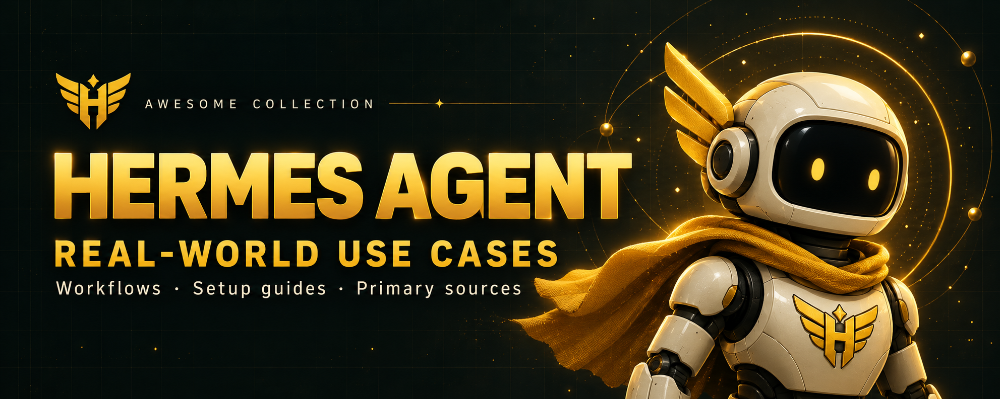

<p align="center">
  
</p>

# Awesome Hermes Agent Use Cases

[](https://awesome.re)


**Practical workflows, community projects, and deployment guides for [Hermes Agent](https://github.com/NousResearch/hermes-agent).**

Browse by the result you want, then open a page for requirements, setup, prompts, and sources. Public evidence and execution testing are different: each page states its validation limits.

## Start here

Six entry points, from everyday automation to specialist tools. These are featured examples, not a difficulty ranking.

| Use case | What you get | Format |
| --- | --- | --- |
| [Daily briefing](usecases/daily-briefing-bot.md) | Scheduled topic research delivered as a morning summary to your messaging app. | Local demo |
| [Team Telegram assistant](usecases/team-telegram-assistant.md) | A shared team bot with per-user sessions and optional Docker terminal isolation. | Local demo |
| [Obsidian second brain](usecases/obsidian-second-brain.md) | Persistent research notes, daily dashboards, and connected knowledge in an Obsidian vault. | Guide |
| [Receipt → structured JSON](usecases/receipt-to-structured-json.md) | Vendor, total, currency, and tag fields extracted from receipt text or images. | Plugin |
| [SEO audits and content briefs](usecases/seo-audits-content-briefs.md) | Technical audits, structured-data checks, local-search analysis, and content briefs. | Plugin |
| [Reverse engineering with REA](usecases/rea-reverse-engineering.md) | Evidence-based inspection of binaries, packages, firmware, and native crash dumps. | Plugin |

## Find a use case

**Browse workflows by goal**

- [Business & Administration](#business--administration) · 10
- [Coding & Engineering](#coding--engineering) · 8
- [Content & Marketing](#content--marketing) · 8
- [Personal Productivity](#personal-productivity) · 7
- [Knowledge & Research](#knowledge--research) · 3
- [Home & Devices](#home--devices) · 3
- [Infrastructure & Security](#infrastructure--security) · 5

**Configure and extend Hermes**

- [Hosting & Model Providers](#hosting--model-providers) · 14
- [Interfaces & Integrations](#interfaces--integrations) · 7
- [Orchestration & Agent Memory](#orchestration--agent-memory) · 12
- [Observability & Evaluation](#observability--evaluation) · 5

**Formats:** **Local demo** includes a starter in this repo; **Plugin**, **Skill**, and **Project** link to an implementation; **Guide** provides a runbook or configuration; **Case study** describes a deployment that may include private components; **Walkthrough** includes planning examples.

A format label describes what is available. It does not mean we ran or audited the integration.

<!-- catalog-list:start -->

## Browse workflows by goal

### Business & Administration

| Use case | What you get | Format |
| --- | --- | --- |
| [Box renewal briefs](usecases/box-renewal-copilot.md) | Cited customer-renewal briefs from approved Box Hub documents. | Guide |
| [ERP and accounting](usecases/erpclaw-plain-english-erp.md) | Invoices, inventory, payroll, and double-entry books through deterministic skill actions. | Skill |
| [First-dollar business guidance](usecases/first-dollar-business-guidance.md) | Evidence-labeled business ideas and a bounded next action from your profile. | Skill |
| [Lead research → YouTrack](usecases/lead-research-youtrack.md) | Prospect research organized into company briefs and prioritized YouTrack tickets. | Case study |
| [Printing-factory task memory](usecases/printing-factory-task-memory.md) | Retrieval of previous tasks and decisions during daily factory operations. | Case study |
| [Receipt → structured JSON](usecases/receipt-to-structured-json.md) | Vendor, total, currency, and tag fields extracted from receipt text or images. | Plugin |
| [Lead → estimate → payment](usecases/service-business-lead-to-payment.md) | A service-job pipeline covering qualification, estimates, reviewed payments, email, and CRM updates. | Skill |
| [Team Telegram assistant](usecases/team-telegram-assistant.md) | A shared team bot with per-user sessions and optional Docker terminal isolation. | Local demo |
| [Teams meeting → action pipeline](usecases/teams-meeting-action-pipeline.md) | Meeting transcripts turned into durable summaries in Teams, Notion, or Linear. | Guide |
| [Feishu and WeCom assistants](usecases/enterprise-messaging-feishu-wecom.md) | Always-on enterprise chat assistants with platform-specific media and vision support. | Case study |

[↑ Browse categories](#find-a-use-case)

### Coding & Engineering

| Use case | What you get | Format |
| --- | --- | --- |
| [Scheduled PR review](usecases/github-pr-review-cron.md) | Periodic pull-request review and digests without a public webhook endpoint. | Guide |
| [Webhook PR review](usecases/github-pr-review-webhook.md) | Pull-request reviews triggered by signed GitHub webhook events. | Guide |
| [Production development workflow](usecases/production-software-dev-workflow.md) | A field report on long coding sessions, delegation, and persistent project context. | Case study |
| [Local model quantization](usecases/dev-local-model-quantization.md) | A documented workflow to quantize, benchmark, and publish models for Apple Silicon. | Guide |
| [Large-spec retrieval](usecases/document-structuring-spec-to-code.md) | Citable retrieval from large specifications and firmware symbols for implementation work. | Skill |
| [Function-calling patterns](usecases/function-calling-patterns.md) | Examples of tool registration, structured output, and recursive multi-step planning. | Project |
| [Reverse engineering with REA](usecases/rea-reverse-engineering.md) | Evidence-based inspection of binaries, packages, firmware, and native crash dumps. | Plugin |
| [Feature planning with sub-agents](usecases/matt-pocock-skills-subagents.md) | A planning-to-issues workflow with example artifacts and delegated implementation steps. | Walkthrough |

[↑ Browse categories](#find-a-use-case)

### Content & Marketing

| Use case | What you get | Format |
| --- | --- | --- |
| [SEO audits and content briefs](usecases/seo-audits-content-briefs.md) | Technical audits, structured-data checks, local-search analysis, and content briefs. | Plugin |
| [X social automation](usecases/x-social-automation-toolset.md) | Search, account reads, trend monitoring, and operator-approved social actions. | Plugin |
| [Email marketing with Sequenzy](usecases/sequenzy-email-marketing-agent.md) | Lifecycle campaign drafts, subscriber workflows, test sends, and email reporting. | Skill |
| [Autonovel: House of Bells](usecases/autonovel-house-of-bells.md) | A published example of a novel, artwork, audiobook, and website production pipeline. | Project |
| [Screen recording → tutorial video](usecases/creative-screen-recording-video.md) | A documented recording-to-script-to-avatar-video workflow with reusable preferences. | Case study |
| [ComfyUI orchestration](usecases/comfyui-workflow-orchestration.md) | Node-based image and video generation workflows launched and managed through Hermes. | Guide |
| [HTML → MP4 video](usecases/video-generation-html-to-mp4.md) | Designed HTML compositions rendered into narrated, animated video files. | Guide |
| [Translation with back-checks](usecases/translation-backcheck-plugin.md) | Translation, classification, and heuristic back-translation checks through an async plugin. | Plugin |

[↑ Browse categories](#find-a-use-case)

### Personal Productivity

| Use case | What you get | Format |
| --- | --- | --- |
| [Daily briefing](usecases/daily-briefing-bot.md) | Scheduled topic research delivered as a morning summary to your messaging app. | Local demo |
| [Inbox → Slack digest](usecases/inbox-slack-daily-digest.md) | A scheduled inbox summary grouped into messages needing replies and FYI items. | Guide |
| [Intent → artifacts](usecases/intent-to-artifacts.md) | Rough requests turned into runbooks, curated feeds, diagrams, and persistent notes. | Case study |
| [Nextcloud workspace assistant](usecases/nextcloud-workspace-assistant.md) | Conversational access to self-hosted files, notes, calendars, tasks, and contacts. | Skill |
| [Personal AI hub](usecases/personal-ai-hub-apple-health-threads-gmail.md) | Health, social, inbox, and calendar context brought into one Telegram workspace. | Case study |
| [Quantified-self Life OS](usecases/quantified-self-life-os.md) | Structured routine tracking with scheduled reflections and evidence-bounded correlation summaries. | Project |
| [Zero-token notifications](usecases/zero-token-notifications.md) | Script-based change detection that calls the model only when there is a signal. | Project |

[↑ Browse categories](#find-a-use-case)

### Knowledge & Research

| Use case | What you get | Format |
| --- | --- | --- |
| [Obsidian second brain](usecases/obsidian-second-brain.md) | Persistent research notes, daily dashboards, and connected knowledge in an Obsidian vault. | Guide |
| [Multi-platform social research](usecases/multi-platform-research.md) | A unified brief from Reddit, X, YouTube, Hacker News, and prediction-market research. | Skill |
| [Weather-market research pattern](usecases/weather-trading-polymarket.md) | A historical weather-feed and market-scoring account; primary source URL missing. | Case study |

[↑ Browse categories](#find-a-use-case)

### Home & Devices

| Use case | What you get | Format |
| --- | --- | --- |
| [Home Assistant control](usecases/home-assistant-control.md) | Conversational entity lookup, state reads, and service calls for a smart home. | Guide |
| [Android device control](usecases/android-device-control.md) | Remote taps, swipes, screenshots, and screen reading from a Hermes conversation. | Plugin |
| [iPhone companion](usecases/hermes-ios-native-engine.md) | An iOS interface with voice, camera, widgets, and permissioned sensor context. | Project |

[↑ Browse categories](#find-a-use-case)

### Infrastructure & Security

| Use case | What you get | Format |
| --- | --- | --- |
| [SRE incident commander](usecases/autonomous-sre-incident-commander.md) | Incident detection, diagnosis, reviewed remediation, verification, and operational learning. | Skill |
| [Network discovery → NetBox](usecases/netbox-network-inventory.md) | A daily discovery-to-inventory workflow with optional Proxmox configuration history. | Case study |
| [Authorized testing with Kali](usecases/autonomous-penetration-testing.md) | A scoped security-assessment workflow with approval gates and structured reports. | Skill |
| [OpenShell sandbox](usecases/hermes-openshell-sandbox.md) | Hermes tools operating within external network, filesystem, syscall, and inference policies. | Project |
| [Stored-reply number masking](usecases/final-response-pii-redaction.md) | Selected SSN and card-number formats masked in stored final replies. | Plugin |

[↑ Browse categories](#find-a-use-case)

## Configure and extend Hermes

### Hosting & Model Providers

| Use case | What you get | Format |
| --- | --- | --- |
| [Nous Portal gateway](usecases/nous-portal-gateway.md) | One authenticated gateway for model access and supported hosted tools. | Guide |
| [Local and proxy backends](usecases/local-and-proxy-models.md) | Hermes configured against a local inference server or compatible model proxy. | Guide |
| [Local model auto-detection](usecases/local-model-auto-detection.md) | Local-server probing that identifies the running model and configures its context window. | Guide |
| [Enterprise model gateways](usecases/enterprise-cloud-deployment.md) | Model-provider configuration for Bedrock, Azure AI Foundry, and NVIDIA endpoints. | Guide |
| [China-region model endpoints](usecases/china-region-llm-endpoints.md) | Provider configuration for Moonshot, MiniMax, and z.ai model services. | Guide |
| [Coding subscriptions as backends](usecases/oauth-cloud-providers.md) | Authentication patterns for supported Copilot, Codex, and Claude subscription backends. | Guide |
| [Headless daemon server](usecases/headless-daemon-server.md) | A supervised Linux gateway with reboot-safe scheduling and dedicated service identity. | Guide |
| [Hermes on Fly.io](usecases/hermes-on-flyio.md) | A Fly Machine deployment with persistent agent state and volume snapshots. | Guide |
| [Hermes on Hugging Face Spaces](usecases/hermes-on-hugging-face-spaces.md) | A hosted dashboard and gateway with state synchronized to a private Dataset. | Project |
| [Browser Harness on Hostinger](usecases/hermes-browser-harness-hostinger.md) | A VPS setup connecting Hermes skills to Browser Use's browser harness. | Guide |
| [Hardened Hetzner deployment](usecases/scicco-hermzner-hetzner.md) | A Terraform and Ansible deployment using rootless containers and Tailscale-only access. | Project |
| [Integrated self-hosted stack](usecases/integrated-self-hosted-hermes-stack.md) | A tiered Docker stack for inference, search, memory, automation, and monitoring. | Project |
| [Declarative Kubernetes fleet](usecases/kubernetes-declarative-agent-fleet.md) | Agent configuration, skills, schedules, and storage reconciled from Kubernetes resources. | Project |
| [Razorpay employee-agent fleet](usecases/razorpay-isolated-employee-agents.md) | A production account of isolated employee agents with controlled, attributable network access. | Case study |

[↑ Browse categories](#find-a-use-case)

### Interfaces & Integrations

| Use case | What you get | Format |
| --- | --- | --- |
| [Browser and admin interfaces](usecases/browser-admin-uis.md) | A comparison of official and community browser interfaces for agent operations. | Guide |
| [Open WebUI frontend](usecases/open-webui-frontend.md) | A browser chat interface connected to the Hermes API server. | Local demo |
| [Terminal operator console](usecases/tui-operator-console.md) | Keyboard-driven access to sessions, skills, schedules, logs, and configuration. | Project |
| [VS Code workspace stream](usecases/hermes-vscode-workspace-stream.md) | Streaming chat, tool output, editor context, and persistent sessions inside VS Code. | Project |
| [Voice assistant workflows](usecases/voice-assistant.md) | CLI microphone conversations, messaging voice notes, and Discord voice interactions. | Guide |
| [Continuous live voice](usecases/hermes-live-voice.md) | Interruptible voice sessions with durable background tasks and reconnect completion notices. | Plugin |
| [Hermes MCP conversation bridge](usecases/hermes-mcp-conversation-bridge.md) | Conversation history, message events, gateway sending, and opt-in tools for MCP clients. | Plugin |

[↑ Browse categories](#find-a-use-case)

### Orchestration & Agent Memory

| Use case | What you get | Format |
| --- | --- | --- |
| [Browser demonstration → skill](usecases/browser-workflow-record-to-skill.md) | A recorded browser demonstration converted into a replayable Hermes skill. | Plugin |
| [Native A2A collaboration](usecases/native-a2a-agent-collaboration.md) | Cross-framework agent discovery and delegation, or Hermes exposed as an authenticated service. | Guide |
| [Kanban agent swarm](usecases/kanban-multi-agent-swarm.md) | A chat request turned into persistent worker, verifier, and synthesizer tasks. | Guide |
| [Paperclip managed employee](usecases/paperclip-managed-employee.md) | Hermes workers coordinated through tasks, checkpoints, and persistent sessions. | Project |
| [Competing AI companies](usecases/competing-autonomous-ai-companies.md) | Two Paperclip teams compared on shared tasks, execution evidence, and skill transfer. | Project |
| [Deterministic workflow delegation](usecases/deterministic-workflow-delegation.md) | Repeatable jobs moved into checked workflow files with budgets and execution traces. | Skill |
| [Project-scoped agents](usecases/per-project-scoped-hermes-agents.md) | Project-specific identity, configuration, skills, sessions, and memory through Ankh.md. | Project |
| [Dynamic Skill Dojo](usecases/dynamic-skill-dojo.md) | Session-driven skill reviews, proposed patches, and optional self-evolution runs. | Skill |
| [Skill self-evolution](usecases/self-evolution.md) | An evaluation-driven loop for optimizing skills, prompts, and tool descriptions. | Project |
| [YantrikDB memory via MCP](usecases/yantrikdb-memory-mcp.md) | Persistent cognitive memory with vector, graph, temporal, and contradiction-aware retrieval. | Project |
| [Hermes Memory OS](usecases/hermes-memory-os.md) | Layered session search, trusted facts, hybrid retrieval, extraction, and a self-curating wiki. | Project |
| [Zouroboros executor bridge](usecases/zouroboros-swarm-bridge.md) | An archived adapter pattern for running Hermes inside a multi-agent orchestrator. | Project |

[↑ Browse categories](#find-a-use-case)

### Observability & Evaluation

| Use case | What you get | Format |
| --- | --- | --- |
| [Labyrinth observability](usecases/hermes-labyrinth-observability.md) | Agent journeys reconstructed from prompts, tools, approvals, failures, and memory activity. | Plugin |
| [Deterministic record and replay](usecases/deterministic-record-and-replay.md) | Offline run replay and checkpoint forks for comparing execution across models. | Project |
| [Local API trace debugging](usecases/local-api-trace-debugging.md) | Provider requests, tool payloads, streamed responses, and token usage in a local viewer. | Project |
| [ClawBench browser evaluation](usecases/clawbench-browser-agent-evaluation.md) | Isolated browser tasks with interception-based scoring and multi-layer execution traces. | Project |
| [RL training and benchmarks](usecases/rl-training-benchmarks.md) | Agent trajectory generation, benchmark evaluation, and reinforcement-learning environment patterns. | Guide |

[↑ Browse categories](#find-a-use-case)

<!-- catalog-list:end -->

## Install Hermes

Choose a workflow first, then follow its setup. For a new Hermes installation:

```bash
curl -fsSL https://raw.githubusercontent.com/NousResearch/hermes-agent/main/scripts/install.sh | bash
hermes setup
```

## Demos and walkthroughs

Three starter demos are included in this repo. They require their own provider and platform configuration:

| Starter | What it demonstrates |
| --- | --- |
| [Daily Briefing](demos/daily-briefing/) | Scheduled research and Telegram delivery |
| [Open WebUI](demos/openwebui/) | Hermes API server with a browser frontend |
| [Team Telegram](demos/team-telegram/) | Shared messaging gateway and Docker terminal backend |

The [Matt Pocock skills walkthrough](demos/matt-pocock-skills/) contains sample plans, PRDs, and issue breakdowns. It is a planning example, rather than a fourth executable starter.

## Evidence and contributing

New entries need a primary public source: official docs, a companion repository, a deployment issue, or a first-person account. Social posts alone belong in the [research backlog](research/unverified.md). Historical evidence gaps are called out in page summaries.

Automated [verification](docs/verification-criteria.md) checks source availability and repository engagement. Those checks do not establish that a workflow works end to end. No integrations were executed during this catalog redesign.

See [CONTRIBUTING.md](CONTRIBUTING.md) for the page template and evidence rules. The [catalog data](catalog.json) keeps categories, summaries, and counts in sync:

```bash
python scripts/render-catalog.py
python scripts/render-catalog.py --check
```

Run the source checker for a new or substantively changed workflow:

```bash
python scripts/verify-usecase.py --usecase usecases/my-topic.md --check all
```

## License

[MIT](LICENSE) for code and configs. Docs and diagrams under [CC BY 4.0](LICENSE-docs).

## Acknowledgements

Catalog format inspired by [awesome-openclaw-usecases](https://github.com/hesamsheikh/awesome-openclaw-usecases). Hermes Agent is built by [Nous Research](https://nousresearch.com).
